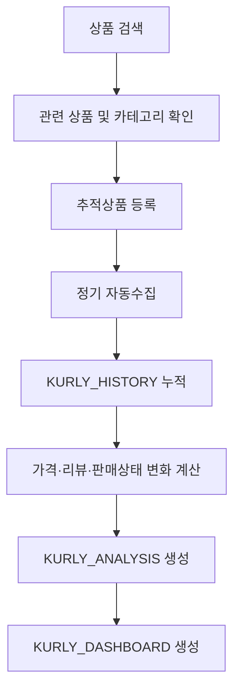
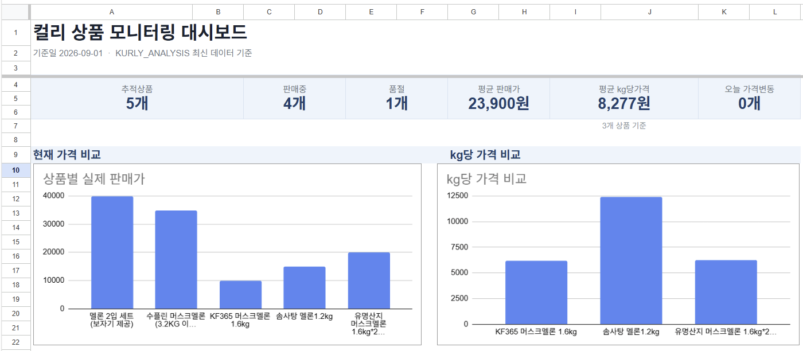

# Kurly Market Monitoring

Google Apps Script를 활용해 컬리의 경쟁상품 정보를 정기적으로 수집하고,  
가격·리뷰·판매상태 변화를 시계열로 추적하기 위해 구축한 시장 모니터링 프로젝트입니다.

## Project Overview

온라인 농산물 및 식품 시장의 가격은 할인, 품절, 상품 구성 변화 등에 따라 지속적으로 변합니다.

단일 시점의 가격 조회만으로는 이러한 변화를 파악하기 어렵기 때문에,  
특정 상품을 지속적으로 추적하여 데이터를 누적하고 가격·리뷰·판매상태 변화를 함께 확인할 수 있는 구조를 설계했습니다.

## Workflow

## Collected Data

주요 수집 항목은 다음과 같습니다.

- 상품 ID
- 상품명
- 정상가
- 판매가
- 할인율
- 단위가격
- 판매상태
- 원산지
- 카테고리
- 배송유형
- 리뷰 수
- 상품 URL

## Analysis

누적된 시계열 데이터를 기반으로 다음과 같은 변화지표를 생성합니다.

- kg당 가격
- 직전 판매가
- 가격 변동액
- 가격 변동률
- 직전 리뷰 수
- 리뷰 증가 수
- 판매상태 변화
- 품절 전환
- 판매 재개

이를 통해 단순한 현재 가격 조회를 넘어 상품별 가격 변화와 시장 움직임을 지속적으로 확인할 수 있도록 구성했습니다.

## Dashboard

Google Sheets에서 추적상품의 최신 상태와 변화를 확인할 수 있는 경쟁상품 모니터링 대시보드를 생성합니다.

주요 구성은 다음과 같습니다.

- 추적상품 현황
- 판매중 / 품절 현황
- 평균 판매가격
- 평균 kg당 가격
- 상품별 실제 판매가격 비교
- 상품별 kg당 가격 비교
- 가격·리뷰·판매상태 변화
- 상품별 판매가격 추이
- 최신 상품 상세현황

## Tech Stack

- Google Apps Script
- Google Sheets
- JavaScript
- Scheduled Trigger
- E-commerce Product Data

## Use Case

농산물 및 식품의 온라인 경쟁상품을 지속적으로 관찰하고,  
단일 가격이 아니라 **가격 변화 · 리뷰 변화 · 판매상태 변화**를 함께 확인하기 위한 데이터 수집 및 분석 Workflow로 활용했습니다.

수집된 데이터는 경쟁상품 모니터링과 온라인 시장 가격구조 분석을 위한 기초 데이터로 활용할 수 있습니다.

## Source Code

본 Repository는 프로젝트의 구조와 구현 결과를 소개하기 위한 Portfolio Repository입니다.

실제 운영에 사용되는 데이터 수집 Source Code는 공개하지 않습니다.
